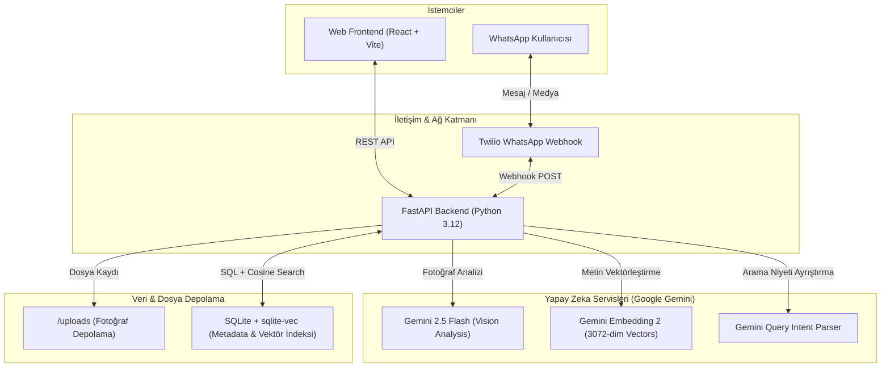

# Aren — AI-Powered Multimodal Photo Memory Assistant 📸🧠

[](https://python.org)
[](https://fastapi.tiangolo.com)
[](https://react.dev)
[](https://ai.google.dev)
[](https://github.com/asg017/sqlite-vec)
[](https://www.twilio.com)

**Aren**, 2 yaşındaki bir çocuğun fotoğraf arşivini hem modern bir web arayüzü hem de **WhatsApp** üzerinden otonom olarak yöneten, multimodal yapay zeka (Vision & Embeddings) ve yerel vektör veritabanı (`sqlite-vec`) ile güçlendirilmiş akıllı bir anı asistanıdır.

---

## 🌟 Öne Çıkan Özellikler

- **🤖 Multimodal AI Fotoğraf Analizi:** Yüklenen her fotoğraf Google Gemini 2.5 Flash ile taranır; baskın duygu durumu, gülümseme/ağlama durumu, mekan/aktivite detayları, kıyafet açıklamaları ve komiklik/sevimlilik skorları yapısal JSON olarak çıkarılır.
- **📱 WhatsApp Otonom Anı Asistanı (Twilio Webhook):**
  - **Medya Alımı (Auto-Ingestion):** WhatsApp'tan fotoğraf veya video gönderildiğinde arka planda otomatik indirilir, AI ile etiketlenir ve arşive kaydedilir.
  - **Doğal Dil ile Arama:** Kullanıcı WhatsApp'tan *"Aren'in parkta çok güldüğü bir anı getir"* yazdığında anında ilgili fotoğraf ve anı özeti WhatsApp medyası olarak yanıtlanır.
- **🔎 Hibrit Arama Motoru (Hybrid Search):** Doğal dil sorguları LLM tarafından **Kesin SQL Filtreleri (Hard Filters)** ve **Anlamsal Arama (Semantic Vector Search)** olarak ayrıştırılır.
- **📐 3072-Boyutlu Vektör Benzerliği:** Gemini Embedding 2 modeli ile üretilen vektörler, SQLite içinde `sqlite-vec` ile yerel ve ultra hafif Kosinüs Benzerliği (Cosine Similarity) ile taranır.
- **🎨 Glassmorphism Web Deneyimi:** React, Vite, TypeScript ve Tailwind CSS ile geliştirilmiş modern, responsive ve duygu/mekan bazlı filtreleme sunan web galerisi.

---

## 🏗️ Sistem Mimarisi



---

## 💡 Çözülen Gerçek Mühendislik Problemleri

### 1. WhatsApp Webhook Zaman Aşımı & Asenkron İşlem (Event-Loop Starvation)
* **Problem:** Twilio webhook'ları 15 saniye içinde HTTP yanıtı bekler. Ağır yapay zeka analizleri ve medya indirme işlemleri FastAPI'nin asenkron event-loop'unu kilitlediğinde bağlantı kopuyordu.
* **Çözüm:** Medya işleme akışı `fastapi.concurrency.run_in_threadpool` kullanılarak iş parçacığı havuzuna (threadpool) devredildi. Bu sayede sunucu eşzamanlı gelen çoklu isteklerde bloke olmadan non-blocking çalışır.

### 2. Anlamsal Çakışma ve Yanılsama Önleme (Semantic Bleed Mitigation)
* **Problem:** Kullanıcı *"Aren'in güldüğü anlar"* aradığında, saf vektör araması arka planda gülen diğer kişilerin fotoğraflarını da Aren sanarak yüksek benzerlik skoruyla getiriyordu.
* **Çözüm:** Sorgu ayrıştırıcı (Query Parser) geliştirildi. Cümledeki duygu ifadeleri (örn: `güldüğü` -> `emotion=mutlu`) kesin SQL filtrelerine aktarıldı ve vektör sorgusundan temizlendi. Böylece vektör arama sadece mekan/nesneye odaklanırken, duygu SQL düzeyinde garanti altına alındı.

### 3. Dış API Hata Toleransı & Otomatik Yeniden Deneme (Exponential Retry)
* **Problem:** Google Gemini API yüksek talep anlarında `503 Service Unavailable` veya `429 Rate Limit` hataları üretebiliyordu.
* **Çözüm:** AI servis katmanına exponential backoff ile 3 aşamalı otomatik yeniden deneme (Retry Loop) ve hata durumunda diskte yetim (orphaned) dosya bırakmayan temizlik mekanizması entegre edildi.

### 4. Modele Bağımsız Adaptif Gap Filtreleme (Model-Agnostic Gap Filtering)
* **Problem:** Sabit benzerlik eşikleri (threshold), farklı model veya veri dağılımlarında alakasız sonuçların listeye sızmasına yol açıyordu.
* **Çözüm:** En yakın sonucun mesafesi ile diğer sonuçlar arasındaki farkı dinamik inceleyen **Adaptive Gap Filter** algoritması geliştirildi.

---

## 🛠️ Teknoloji Yığını

| Katman | Teknoloji | Tercih Nedeni |
|---|---|---|
| **Backend** | Python 3.12, FastAPI, Uvicorn | Yüksek asenkron G/Ç performansı ve modern Python ekosistemi |
| **Frontend** | React 18, TypeScript, Vite, Tailwind CSS | Tip güvenliği, bileşen modülerliği ve hızlı derleme |
| **Multimodal Vision** | Google Gemini 2.5 Flash | Karmaşık duygusal ve bağlamsal sahneleri yapılandırılmış JSON olarak çıkarma |
| **Embeddings** | `gemini-embedding-2` | 3072 boyutlu zengin anlamsal vektör uzayı |
| **Vector Database** | SQLite + `sqlite-vec` | Harici ağır vektör DB sunucularına gerek duymayan hafif, yerel ve taşınabilir mimari |
| **Messaging** | Twilio WhatsApp API | Güvenilir webhook ve zengin medya bildirim altyapısı |

---

## 🚀 Hızlı Başlangıç (Kurulum)

Projede tüm operasyonlar pratiklik için `Makefile` üzerinden yönetilmektedir.

### 1. Depoyu Klonlayın
```bash
git clone https://github.com/<kullanici-adiniz>/aren-photo-memory.git
cd aren-photo-memory
```

### 2. Ortam Değişkenlerini Tanımlayın
```bash
cp backend/.env.example backend/.env
```
`backend/.env` dosyasını açıp kendi API anahtarlarınızı girin:
```env
GEMINI_API_KEY=your_gemini_api_key
GEMINI_MODEL=gemini-2.5-flash
EMBEDDING_MODEL=gemini-embedding-2
DATABASE_URL=sqlite:///./aren.db
UPLOAD_DIR=./uploads
BASE_PUBLIC_URL=https://your-subdomain.ngrok-free.app
TWILIO_ACCOUNT_SID=your_twilio_sid
TWILIO_AUTH_TOKEN=your_twilio_token
```

### 3. Bağımlılıkları Yükleyin
```bash
make install
```

### 4. Uygulamayı Başlatın
Frontend ve Backend'i aynı anda ayağa kaldırmak için:
```bash
make dev
```
- **Web UI:** `http://localhost:5173`
- **FastAPI Swagger Docs:** `http://localhost:8000/docs`

---

## 📂 Proje Dizin Yapısı

```text
aren/
├── Makefile                     # Tek komutla build/run yönetim otomasyonu
├── README.md                    # Proje teknik dokümantasyonu
├── backend/
│   ├── app/
│   │   ├── main.py              # FastAPI giriş noktası & middleware yapılandırması
│   │   ├── config.py            # Pydantic BaseSettings ile tip güvenli konfigürasyon
│   │   ├── database.py          # SQLite & sqlite-vec bağlantı ve şema yönetimi
│   │   ├── schemas.py           # Pydantic DTO ve API validasyon modelleri
│   │   ├── routers/
│   │   │   ├── photos.py        # Fotoğraf yükleme ve listeleme endpoint'leri
│   │   │   ├── search.py        # Anlamsal arama ve filtreleme endpoint'leri
│   │   │   ├── filters.py       # Dinamik filtre seçenekleri API'si
│   │   │   └── whatsapp.py      # Twilio WhatsApp webhook & medya işleme motoru
│   │   └── services/
│   │       ├── gemini.py        # Gemini API istemcisi & retry mekanizması
│   │       ├── photo_service.py # Fotoğraf işleme, vision analizi ve DB yazımı
│   │       └── search_service.py# Hibrit arama, SQL filtreleme ve vektör benzerliği
│   └── requirements.txt
├── frontend/
│   ├── src/
│   │   ├── api/client.ts        # Axios tabanlı tip güvenli API istemcisi
│   │   ├── components/          # Yeniden kullanılabilir UI bileşenleri
│   │   └── pages/Gallery.tsx    # Anı galerisi ve arama arayüzü
│   ├── package.json
│   └── vite.config.ts
└── docs/                        # Mimari tasarım belgeleri ve karar kayıtları (ADR)
```

---

## 📄 Lisans
Bu proje kişisel araştırma ve portföy vitrini amacıyla geliştirilmiştir.
