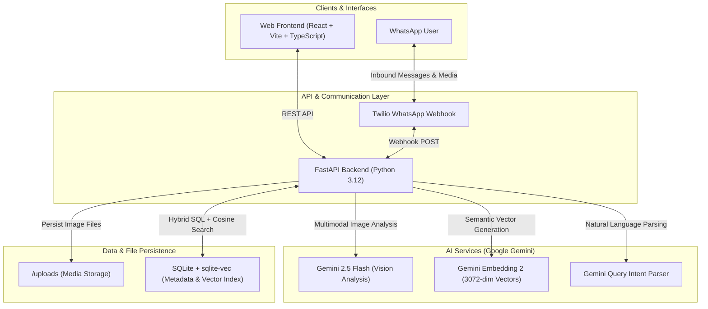

# Aren — Autonomous Multimodal AI Photo Memory Assistant 📸🧠

[](https://python.org)
[](https://fastapi.tiangolo.com)
[](https://react.dev)
[](https://ai.google.dev)
[](https://github.com/asg017/sqlite-vec)
[](https://www.twilio.com)

**Aren** is an end-to-end, production-grade photo memory assistant designed to capture, analyze, and query family memories using multimodal AI (**Google Gemini Vision & Embeddings**) and a lightweight local vector database (**`sqlite-vec`**). The system features dual interaction surfaces: a glassmorphism **React web dashboard** and an autonomous **WhatsApp bot** powered by Twilio webhooks.

---

## 🌟 Key Features

- **🤖 Multimodal AI Vision Analysis:** Every uploaded photo is automatically parsed by Gemini 2.5 Flash to extract structured JSON metadata: dominant emotions, smiling/crying states, location context, activities, apparel descriptions, and funniness/cuteness scores.
- **📱 WhatsApp Ingestion & Natural Language Retrieval:**
  - **Automated Media Ingestion:** Receiving photos or videos via WhatsApp triggers automatic download, AI labeling, vector embedding, and storage.
  - **Conversational Memory Search:** Users can text queries like *"Send me photos of Aren laughing at the park"*, and the bot retrieves the best match and sends it back with contextual AI commentary directly on WhatsApp.
- **🔎 Hybrid Query Engine (SQL Filters + Vector Search):** Employs an LLM query-intent parser that separates natural language into strict SQL filters (e.g., `emotion = "happy"`) and clean semantic descriptions for vector similarity.
- **📐 3072-Dimensional Dense Vector Search:** Uses `gemini-embedding-2` and `sqlite-vec` to run sub-millisecond local cosine similarity searches without the operational overhead of heavy external vector databases.
- **🎨 Modern Glassmorphism Web Interface:** Built with React 18, Vite, TypeScript, and Tailwind CSS, offering real-time filtering, instant search debouncing, and memory inspection modals.

---

## 🏗️ System Architecture



---

## 💡 Engineering Challenges & Technical Highlights

### 1. Webhook Concurrency & Event-Loop Starvation
* **Challenge:** Twilio webhooks enforce a strict 15-second response timeout. Running synchronous image processing and heavy network calls directly inside the asynchronous route handlers caused event-loop blocking, leading to 504 Gateway Timeouts during multi-photo uploads.
* **Solution:** Decoupled media ingestion using `fastapi.concurrency.run_in_threadpool`. Heavy I/O and AI calls are offloaded to an asynchronous worker thread pool, ensuring non-blocking execution and sub-second webhook acknowledgment.

### 2. Mitigating Semantic Bleed & Hallucinations
* **Challenge:** When searching for *"Aren laughing"*, a pure vector search often surfaced pictures where background individuals were laughing while Aren was neutral, due to the high semantic similarity of the concept "laughing".
* **Solution:** Designed a hybrid query parsing pipeline. Natural language requests are first parsed by an LLM into:
  1. **Strict Metadata Filters:** Categorical attributes (e.g., `emotions: ["happy"]`, `location_type: ["outdoor"]`).
  2. **Sanitized Vector Query:** Emotional descriptors are stripped from the vector string, preventing query pollution and ensuring exact attribute compliance via SQL `WHERE` clauses combined with vector distance ranking.

### 3. Fault-Tolerant External API Retries
* **Challenge:** High traffic spikes on upstream Google Gemini endpoints occasionally resulted in `503 Service Unavailable` or `429 Rate Limit` responses.
* **Solution:** Implemented an exponential backoff retry mechanism (up to 3 attempts with progressive delay) and transactional file management that purges orphaned image artifacts if analysis fails completely.

### 4. Model-Agnostic Adaptive Gap Filtering
* **Challenge:** Static distance thresholds fail when query distributions or embedding models shift, causing either false positives or missing relevant results.
* **Solution:** Developed an adaptive gap filtering strategy that dynamically evaluates the distance delta between the top-ranked match and subsequent candidates, discarding sudden semantic drop-offs.

---

## 🛠️ Technology Stack

| Layer | Technology | Rationale |
|---|---|---|
| **Backend** | Python 3.12, FastAPI, Uvicorn | High asynchronous I/O performance and native AI ecosystem compatibility |
| **Frontend** | React 18, TypeScript, Vite, Tailwind CSS | Strong type safety, reusable component architecture, and rapid build times |
| **Multimodal Vision** | Google Gemini 2.5 Flash | High-accuracy structured schema extraction from complex emotional scenes |
| **Embeddings** | `gemini-embedding-2` | Rich 3072-dimensional semantic representation space |
| **Vector Database** | SQLite + `sqlite-vec` | Zero-configuration, embedded, and lightning-fast local vector similarity indexing |
| **Messaging Gateway** | Twilio WhatsApp API | Standardized webhook interface for cellular messaging and rich media delivery |

---

## 🚀 Quickstart & Installation

All development tasks are automated using the project's `Makefile`.

### 1. Clone the Repository
```bash
git clone https://github.com/hazaltasss/aren-photo-memory.git
cd aren-photo-memory
```

### 2. Configure Environment Variables
```bash
cp backend/.env.example backend/.env
```
Populate `backend/.env` with your API credentials:
```env
GEMINI_API_KEY=your_gemini_api_key
GEMINI_MODEL=gemini-2.5-flash
EMBEDDING_MODEL=gemini-embedding-2
DATABASE_URL=sqlite:///./aren.db
UPLOAD_DIR=./uploads
BASE_PUBLIC_URL=https://your-subdomain.ngrok-free.app
TWILIO_ACCOUNT_SID=your_twilio_sid
TWILIO_AUTH_TOKEN=your_twilio_token
```

### 3. Install Dependencies
```bash
make install
```

### 4. Start the Application
Run both backend and frontend servers simultaneously:
```bash
make dev
```
- **Web UI:** `http://localhost:5173`
- **FastAPI Interactive Docs:** `http://localhost:8000/docs`

---

## 📂 Project Structure

```text
aren/
├── Makefile                     # Build & run automation commands
├── README.md                    # Project documentation & architecture showcase
├── backend/
│   ├── app/
│   │   ├── main.py              # FastAPI app initialization & CORS middleware
│   │   ├── config.py            # Pydantic BaseSettings for type-safe environment configuration
│   │   ├── database.py          # SQLite connection & sqlite-vec extension loader
│   │   ├── schemas.py           # Pydantic DTOs & response schemas
│   │   ├── routers/
│   │   │   ├── photos.py        # Photo upload & gallery endpoints
│   │   │   ├── search.py        # Semantic vector search & filtering endpoints
│   │   │   ├── filters.py       # Dynamic filter option aggregation
│   │   │   └── whatsapp.py      # Twilio WhatsApp webhook & media handler
│   │   └── services/
│   │       ├── gemini.py        # Gemini client wrapper with exponential retry logic
│   │       ├── photo_service.py # Image ingestion, vision analysis, & vector storage
│   │       └── search_service.py# Hybrid search execution & distance gap filtering
│   └── requirements.txt
├── frontend/
│   ├── src/
│   │   ├── api/client.ts        # RTK Query / Axios type-safe API client
│   │   ├── components/          # Reusable UI & modal components
│   │   └── pages/Gallery.tsx    # Memory gallery & interactive search interface
│   ├── package.json
│   └── vite.config.ts
└── docs/                        # Architecture Decision Records (ADRs) & specs
```

---

## 📄 License
This project is developed for personal research, educational purposes, and engineering portfolio presentation.
